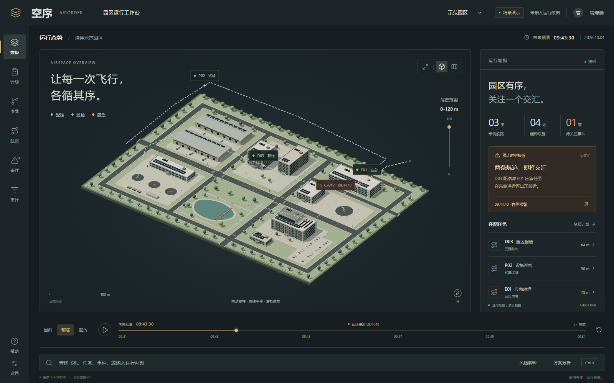

# 空序 AIRORDER · 城市低空多机协同调度与航路规划决策平台


面向城市低空物流与巡检场景的**多无人机（UAV）协同调度、四维航迹冲突检测与三维态势可视化平台**。



---

## 核心特性

- **全链路冲突消解工作流**
  - 完整实现**“时空冲突检测 → 候选解脱方案比对 → 多方协调确认 → 外部执行回执 → 实时运行态势观测 → 全流程审计存证”**的闭环调度逻辑。
- **三维城市园区态势感知**
  - 基于 Three.js 与 Blender 自建城市园区 GLB 模型，实时渲染低空空域网格、建筑物安全包络、多机四维航迹线及冲突预警热区。
- **多指标方案权衡对比**
  - 针对高度层调配、航路绕飞、时隙延误等不同消解策略，直观对比延误时长、额外能耗、安全裕度与空域容量影响。

---

## 快速启动

环境要求：Node.js 20.19+ 或 22.12+。

```bash
cd prototype
npm ci
npm run dev
```

浏览器访问 `http://127.0.0.1:4173`（Windows 用户也可在构建后直接运行 `prototype/启动原型.cmd`）。

### 构建与预览

```bash
cd prototype
npm run build
npm run preview
```

详细交互体验步骤参见 [prototype/README.md](prototype/README.md)。

---

## 目录结构

```text
urban-low-altitude-uav-planning/
├── prototype/          # React + TypeScript + Three.js 低空调度交互原型及测试
├── design/
│   ├── blender/        # Blender 园区原始建模工程与自动化生成脚本
│   └── models/         # 导出的园区三维 GLB 模型资产
└── _build/             # 工程文档构建脚本
```
